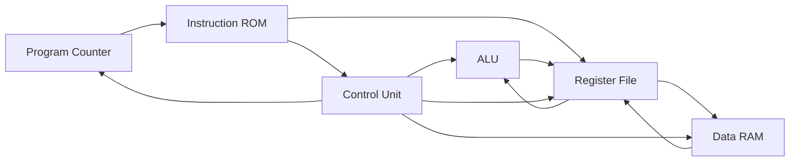

# TR-8

TR-8 is a small, single-cycle, 8-bit processor implemented in synthesizable
VHDL-2008. It is intended as an educational design showing the relationship
between instruction fetch, decode, register operands, ALU execution, memory,
write-back, and sequential state.

## Architecture

- 8-bit data and address paths
- 16-bit instruction ROM, 256 words
- 8-bit data RAM, 256 bytes
- Four 8-bit general-purpose registers (R0-R3)
- Synchronous active-high reset
- Asynchronous ROM and register reads
- Synchronous register, RAM, PC, zero-flag, and HALT state updates



The PC increments after each ordinary instruction. A jump takes priority over
incrementing, while HALT disables the PC and all writes. The zero flag is
updated only when an instruction writes a register; it is therefore the
committed result flag used by JZ.

## Instruction format

```
15..12   11..10   9..8     7..0
 opcode     RD      RS    immediate
```

| Opcode | Instruction | Meaning |
|---|---|---|
| 0 | NOP | No state change |
| 1 | LDI | `RD <- immediate` |
| 2 | ADD | `RD <- RD + RS` |
| 3 | SUB | `RD <- RD - RS` |
| 4 | AND | `RD <- RD and RS` |
| 5 | OR | `RD <- RD or RS` |
| 6 | XOR | `RD <- RD xor RS` |
| 7 | LOAD | `RD <- RAM[immediate]` |
| 8 | STORE | `RAM[immediate] <- RD` |
| 9 | JMP | `PC <- immediate` |
| A | JZ | Jump when the committed zero flag is set |
| B | HALT | Hold PC and all architectural state |
| C | NOT | `RD <- not RD` |
| D-F | Reserved | NOP policy |

The ROM sample program is `LDI R0,5; LDI R1,3; ADD R0,R1; STORE 0x10,R0;
HALT`, encoded as `1005 1403 2100 8010 B000`. Its final result is
`R0 = 08`, `R1 = 03`, and `RAM[10] = 08`.

## Build and simulation

Install GHDL and optionally GTKWave, then run from `C:\TR-8`:

```bat
compile.bat
test_all.bat
simulate_cpu.bat
```

`simulate_cpu.bat` writes `sim\tr8_cpu.ghw`. Set `GTKWAVE_PATH` to a full
GTKWave executable path when it is not on `PATH`. Open the generated GHW file
in GTKWave and add signals under `tb_tr8_cpu/dut`, including the PC,
instruction, decoded fields, ALU signals, register write-back signals, RAM
signals, `DEBUG_ZERO`, and `HALTED`.

To assemble a readable program, use:

```bat
python tools\tr8_assembler.py programs\store_load.asm
```

The shared encoding package is
[`src/tr8_isa_pkg.vhd`](src/tr8_isa_pkg.vhd), and the CPU accepts a typed ROM
generic so integration tests can provide alternate programs without changing
the processor datapath.

To change the default sample program, edit `SAMPLE_PROGRAM` in
[`src/tr8_isa_pkg.vhd`](src/tr8_isa_pkg.vhd) and rerun the tests.

## Files and limitations

The `src` directory contains one entity per hardware module plus the shared ISA
package. The `tb` directory contains an assertion-based testbench for every
module and a generic-program CPU integration test. The current ROM is a fixed
synthesizable constant and there is no external program-loading interface,
interrupt mechanism, or pipeline. FPGA block-RAM inference is not claimed;
see [`docs/fpga_implementation.md`](docs/fpga_implementation.md).
