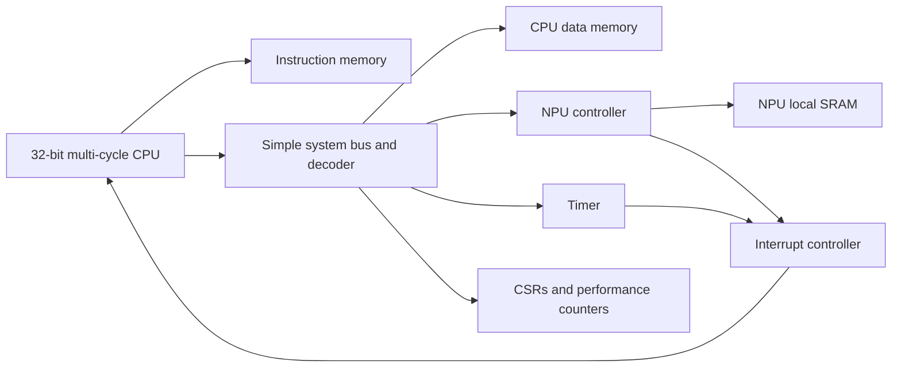

# TR-8-A32N Architecture

TR-8-A32N is the planned second generation of the TR-8 processor family. The
existing 8-bit TR-8 remains the stable reference implementation. This design
adds a separate 32-bit scalar CPU and a small INT8 neural-processing
accelerator without changing the legacy interfaces.

## Design goals

- Be synthesizable VHDL-2008 suitable for educational FPGA work.
- Prefer deterministic, independently testable modules.
- Use a multi-cycle CPU before attempting pipelining.
- Use a 2x2 INT8 processing-element array as the first NPU.
- Keep CPU/NPU communication memory-mapped.
- Validate every hardware result against a Python reference model.

## System organization

The first SoC uses a simple shared data bus. The CPU is the only bus master
initially. The NPU operates on its local SRAM after software has populated it,
so accelerator execution does not require bus arbitration for every MAC.

## CPU execution model

The CPU is multi-cycle. A typical instruction uses these states:

1. `FETCH`
2. `DECODE`
3. `EXECUTE`
4. `MEMORY_READ` or `MEMORY_WRITE` when required
5. `WRITEBACK`
6. `TRAP` for illegal instructions or faults

This avoids forcing instruction memory, register reads, ALU execution, data
memory, and write-back into one clock period. A pipeline is intentionally
deferred until the unpipelined implementation has synthesis and verification
baselines.

## CPU resources

- 32-bit program counter
- 32 x 32-bit general-purpose registers
- 32-bit ALU
- Two register-read ports and one write port
- Byte-addressed 32-bit data path
- Control and status registers
- Synchronous reset
- Trap and interrupt entry
- Debug and performance counters

Register `x0` is hardwired to zero. `x1` is the link register and `x2` is the
stack pointer. The remaining ABI conventions are documented in
[`cpu_isa.md`](./cpu_isa.md).

## NPU resources

The first NPU contains four signed INT8 multiply-accumulate processing
elements arranged as a 2x2 array. Products are accumulated in 32-bit signed
registers. The datapath supports matrix multiplication, bias addition, ReLU,
and bounded output quantization.

The first implementation uses explicit local SRAM regions for inputs, weights,
biases, and outputs. A CPU-visible register interface configures one operation.
Polling is implemented before completion interrupts.

## Architectural boundaries

The legacy TR-8 remains under the existing `src` and `tb` hierarchy. New
TR-8-A32N RTL will use a separate hierarchy such as `src/tr8_ai` and
`tb/tr8_ai`. Shared concepts may be reimplemented with 32-bit interfaces;
legacy entities will not be widened in place.

## Deferred features

The following are deliberately outside the first implementation:

- CPU pipelining
- Cache hierarchy
- DMA
- Coherent shared CPU/NPU memory
- INT4 and FP16 arithmetic
- GPU-style SIMT execution
- Operating-system-level virtual memory

These features require measurements from the simpler implementation.
